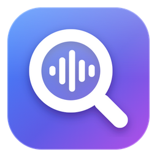
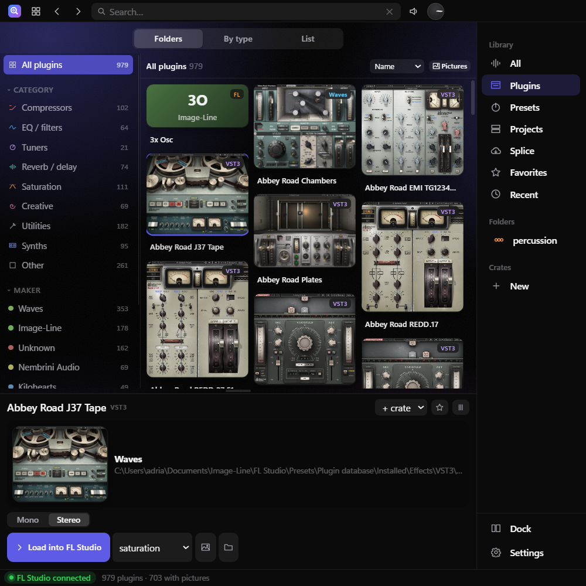
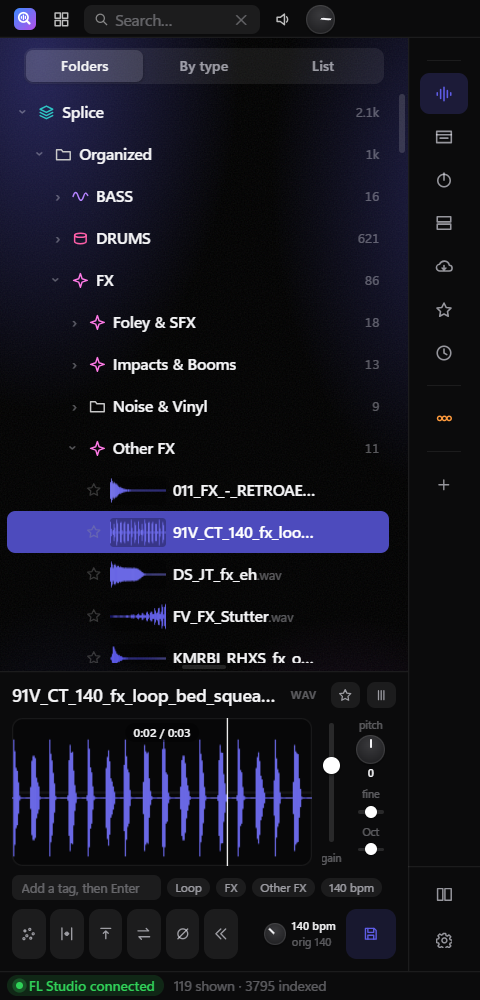
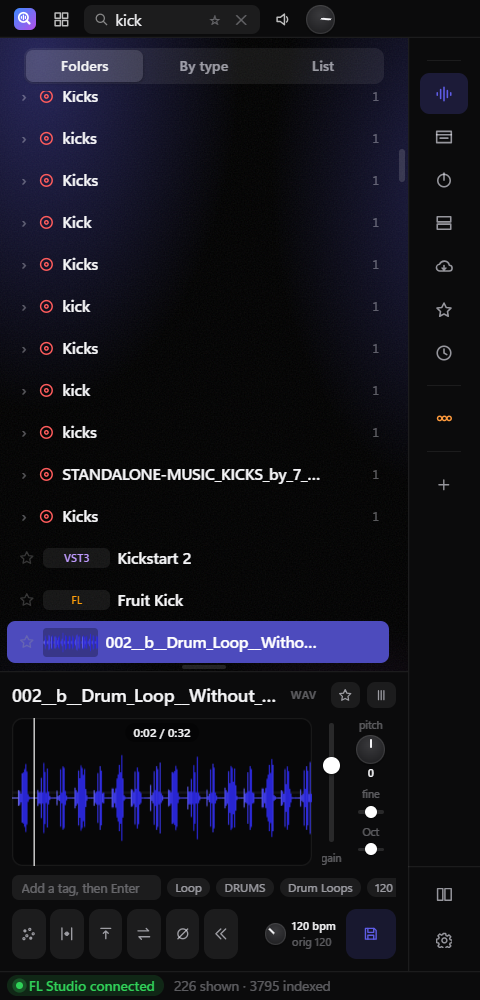
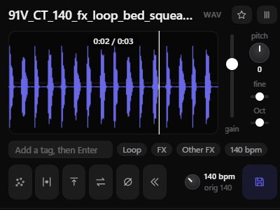
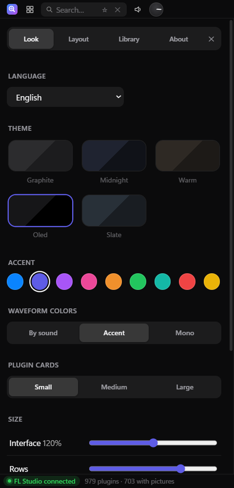
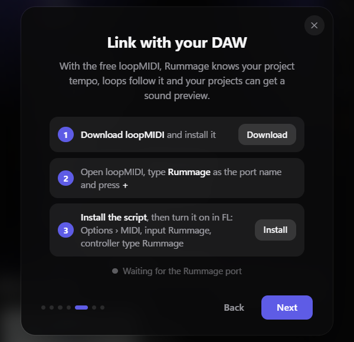

<p align="center"></p>

<h1 align="center">Rummage</h1>

<p align="center"><b>Your samples, plugins and presets in one panel beside FL Studio or Ableton Live.</b><br>
Find a sound in seconds, see every plugin as it really looks, and drag anything straight into your project.</p>

<p align="center">
  <a href="https://github.com/mitoisgrowing/rummage/releases/latest"><b>Download for Windows</b></a> ·
  free and open source · English, Español, Français, Deutsch, Português, Italiano
</p>

<p align="center"></p>

## Why Rummage

Your DAW's browser was built for one library. Rummage puts Splice, your own folders, every plugin format and your projects in one place, docked on the edge of the screen while your DAW fills the rest.

## Features

### Find sounds fast
- **One library for everything.** Splice samples, your own folders, the Ableton User Library, FL Studio's audio and plugin database, VST3, VST2, CLAP, Waves, and Live's and FL's own devices.
- **Waveforms everywhere.** Every sample gets a small waveform tinted by timbre (warm for lows, cool for highs).
- **Play as you browse.** Move with ↑ ↓ and each sample plays. Click anywhere on the waveform to play from there.
- **Search that understands music.** Type a name, or narrow it with `bpm:140` and `key:Am`. Save searches you use often.
- **Sorted by type, if you want.** Turn on *By type* to sort every sample into Kicks, Snares, Hi-hats, 808s & Bass, Vocals, FX and more, each split into Loops and One-shots. Your folders stay untouched.

### Plugins you can see
- **A gallery of real plugin pictures.** Rummage opens each VST3 on its own, out of sight, and photographs it, so the Plugins view shows every plugin as it looks. Your DAW and projects are not touched, and it takes about 2 seconds per plugin. A live card shows progress as the gallery fills in.
- **Sorted by job.** Compressors, EQ, tuners, reverb/delay, saturation, creative effects, utilities and synths, plus a filter by maker.
- **Accurate detection.** VST3 categories come from each plugin's own metadata, helper DLLs are left out, and Mono/Stereo versions are shown as one plugin with a picker.

### Works with your DAW
- **FL Studio and Ableton Live.** Drag plugins, samples, racks and presets into your project, and the buttons and texts follow the DAW you use.
- **Docks on either edge.** Rummage sits on the left or right of the screen and resizes your DAW to fill the rest. *Automatic* follows wherever you put the window.
- **Tempo link (loopMIDI).** A small DAW script tells Rummage your project tempo, and loops follow it while you preview.
- **Project previews (optional).** When you press play in your DAW, Rummage records 3 seconds of the project, so you can tell projects apart by ear in *Projects*.

### Preview and edit
- **Independent pitch and tempo.** Pitch, fine and octave change the key without changing speed. Tempo changes speed (shown in BPM) without changing the key.
- **Quick edits.** Trim, normalize, swap L/R, polarity, reverse and gain. *Save* writes a new WAV into `Documents\Rummage\Edits`.

### Make it yours
- Five themes, accent colors, generated backgrounds (mesh, waves, dots) or your own photo with opacity and blur.
- Interface size, row height, card size, and a switch for every part of the interface.
- Favorites, tags, color labels, custom folder icons, crates and pinned folders.
- A short welcome tour on first launch, which you can see again from *Settings → About*.

## Screenshots

| Library | Search | Preview panel |
| --- | --- | --- |
|  |  |  |

| Settings | DAW link setup |
| --- | --- |
|  |  |

## Install

Download `Rummage Setup x.y.z.exe` from the [Releases](https://github.com/mitoisgrowing/rummage/releases/latest) page and run it.

> The installer is not code-signed yet, so Windows SmartScreen may warn you. Click *More info → Run anyway*.

## Link Rummage with your DAW (optional)

1. Install the free [loopMIDI](https://www.tobias-erichsen.de/software/loopmidi.html) and create a port named **Rummage**.
2. In Rummage, open *Settings → Library → DAW link* and click **Install script**.
3. Turn it on in your DAW:
   - **FL Studio:** *Options → MIDI settings*, select the *Rummage* input, set the controller type to *Rummage* and port 52, then set the *Rummage* output to port 52 too.
   - **Ableton Live:** *Settings → Link, Tempo & MIDI*, set a Control Surface to *Rummage* with *Rummage* as input and output.

The status bar then shows the project tempo, for example *FL Studio connected · 140 BPM*.

## Save racks and channels from Live

1. In Live's browser, click **Add Folder** under *Places* and pick `Documents\Rummage\Library`.
2. Drag any device, rack or whole track into that folder. Live saves it as `.adv`, `.adg` or `.als`.
3. It appears in Rummage under **My Library**, ready to drag back into any set.

## Keyboard

| Key | Action |
| --- | --- |
| ↑ / ↓ | Move through the list (samples play automatically) |
| ← / → | Collapse / expand a folder |
| Space | Play / stop |
| Enter | Open a folder, or find the selected plugin in your DAW |
| F | Favorite |
| Ctrl + / Ctrl − / Ctrl 0 | Interface size |
| Esc | Clear search |

## Run from source

```bash
git clone https://github.com/mitoisgrowing/rummage.git
cd rummage
npm install
npm start
```

| Script | What it does |
| --- | --- |
| `npm start` | Run the app |
| `npm run icons` | Re-render `assets/icon.png` and `build/icon.ico` from `assets/icon.svg` |
| `native\build.bat` | Build `vst3snap.exe`, the helper that photographs plugins (needs Visual Studio Build Tools) |
| `npm run dist` | Build the Windows installer into `dist/` (run `native\build.bat` first) |

## Limitations

- Windows only for now.
- Plugin pictures work for VST3 and Waves. A few plugins refuse to open outside a real DAW (Arturia's, for example) or ask for a first-run consent screen; those keep a colored tile, or you can give them a picture by hand.
- "Load into Ableton" focuses Live's own search with the plugin name; you still press Enter in Live. Samples, racks and presets load by drag and drop.
- In FL Studio, plugins load through FL's plugin database, so FL needs to have scanned them once (*Options → Manage plugins*).
- Project previews record whatever the computer is playing at that moment, so they are off until you turn them on.

## Contributing

[Issues](https://github.com/mitoisgrowing/rummage/issues) and pull requests are welcome. The app is plain Electron with no framework:

- `main.js` scans the disk and talks to Windows.
- `preload.js` exposes a small API.
- `index.html` holds the whole UI, and `i18n.js` its translations.
- `native/vst3snap.cpp` is the plugin photographer, a tiny VST3 host with no SDK dependency.
- `daw/` holds the FL Studio and Ableton Live scripts for the tempo link.

## License

[MIT](LICENSE)
